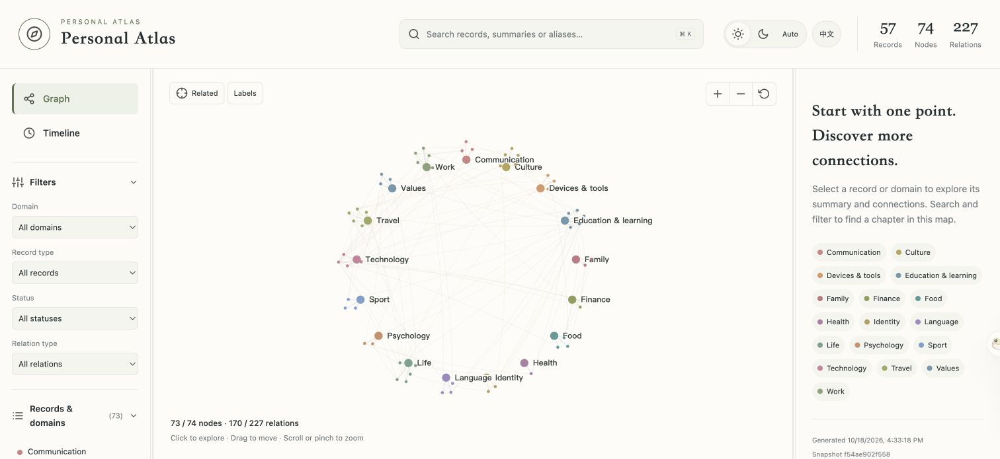
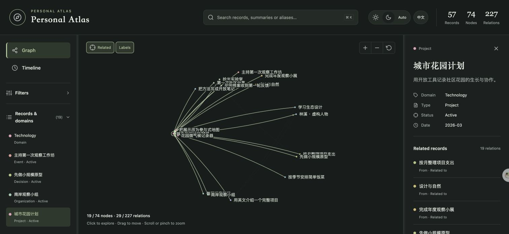
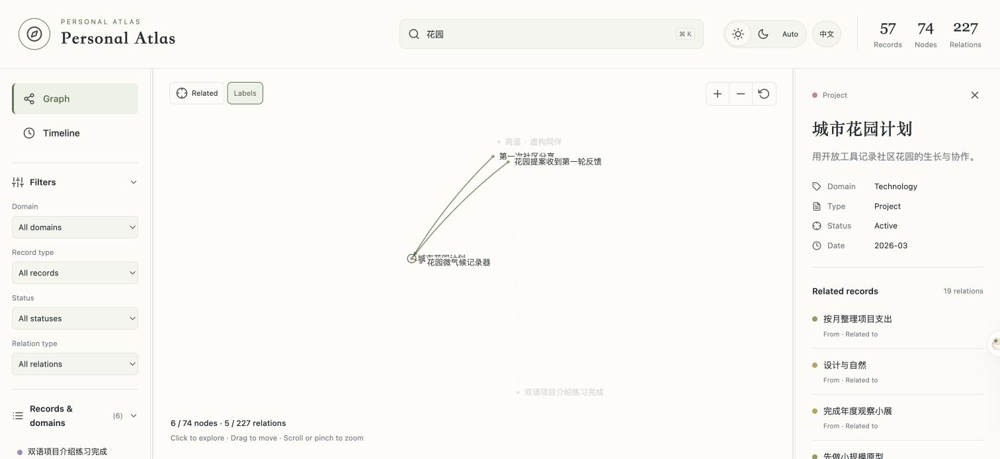
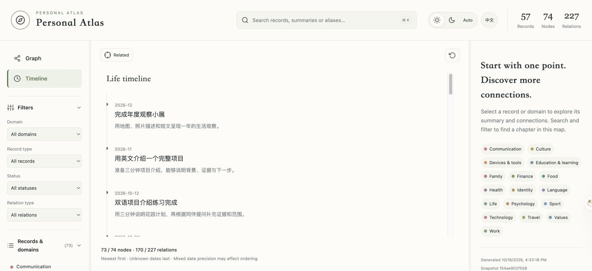

# Personal Atlas

**Give your AI a personal knowledge map you can inspect, correct, and own.**

[简体中文](README.zh-CN.md) · [Skill instructions](SKILL.md) · [Contributing](CONTRIBUTING.md) · [MIT license](LICENSE)

Personal Atlas is an agent skill that turns the experiences, projects, preferences,
goals, and relationships you choose to save into a traceable knowledge base.
Markdown holds the details and original sources; a JSON graph connects them.
Your data lives in a Git repository you control, accessed through your agent's
existing tools.



*Actual exported interface, using entirely fictional records. The visualization template supports Chinese and English. Use the language toggle
to the right of the theme controls; Chinese is the default and the choice is
saved locally. Record content stays in its original language. Skill instructions
are primarily in Chinese; project documentation is available in both languages.*

## What you can do

- **Build your Atlas with a guided interview.** Twelve topic groups help you
  capture the parts of your life you want to keep. Skip questions or say “do not save.”
- **Ask questions with evidence.** Follow people, projects, events, and their
  connections back to records and original sources.
- **Keep change and uncertainty visible.** Distinguish facts from inferences,
  retain real-world dates, and correct or retract inaccurate records.
- **Explore an offline map.** Search, filter, zoom, follow relationships, switch
  themes, and browse a timeline in a self-contained HTML export.
- **Own portable files.** No dedicated hosted Atlas service or vector database
  is required. Git provides version history and a format you can inspect.

## See it in action

The fictional demo includes **56 personal records and one source**, organized
across **17 domains, 74 graph nodes and 227 relationships**. It connects projects,
collaborators, learning, family routines, creative work, travel, decisions, and goals.
All screenshots below use the English interface; record content remains in its
original language.

### Follow connections in dark mode

Select a project and focus its neighbors to explore collaborators, milestones,
related decisions, and source links. The inspector keeps summaries and relationship
labels beside the graph.



### Search and filter without losing context

Search original record text and combine domain, type, status, and relationship
filters. Counts distinguish the visible subset from the complete embedded graph.



### Browse experiences and plans over time

Switch to the timeline to review dated events, decisions, projects, and goals.
Dates keep their recorded precision; changing the interface language does not
translate your records.




## Get started

### 1. Install the skill

Clone this repository into a directory named `personal-atlas` within your agent's
skills folder, or import it using your host's skill installation interface.
For a local Codex installation:

```sh
git clone https://github.com/Charlie-BU/Personal-Atlas.git ~/.codex/skills/personal-atlas
```

The repository root is the skill directory: `SKILL.md`, `references/`, `scripts/`,
and `assets/` must stay together. Other hosts must support agent skills and
provide their own compatible repository tools. This is a standalone skill,
not an automatically connected MCP server or a hosted web application.

### 2. Connect your personal data repository

Choose a Git repository you control; a private personal-data repository is
recommended. It can be empty or already contain files and other skills' data.
Atlas manages only **`atlas/`**, alongside directories such as `plans/` and `health/`.
Connect your agent's Git tools and authorize access to that repository.

Tell your agent, for example:

> Use Personal Atlas. My personal data repository is
> `https://github.com/YOUR-NAME/YOUR-PRIVATE-ATLAS`. Check access, initialize `atlas/` if absent,
> and guide me through the first interview. Ask before saving sensitive topics.

Repository configuration can come from the conversation, host/plugin settings,
or an optional external `~/.config/personal-atlas/config.json`. No local config
file or additional PAT is needed when the host already has sufficient context
and authorization. Keep credentials outside this skill and out of chat.

GitHub, GitLab, Gitee, and self-hosted Git services can be used **when the host
provides compatible tools**. The skill does not include authentication or a
remote client. Writes require a trusted calculation/validation capability,
a multi-file atomic commit, concurrency protection, and remote readback.
Provider compatibility is a capability contract, not a claim of live testing
against every provider. See [connector requirements](references/connector.md).

### 3. Save, retrieve, and explore

Try requests such as:

- “Guide me through documenting my projects; let me skip any question.”
- “What led to this decision? Show the original sources.”
- “Update this preference; the old description is no longer accurate.”
- “Generate my interactive Atlas, including the timeline.”

Initialization is successful only after a real remote commit and readback.
The helper scripts returning `prepared` means changes are ready for the host to
publish; it does not mean your data was saved remotely.

## Share one repository across personal skills

```text
personal-data/
├── README.md           # Existing files are preserved
├── atlas/
│   ├── vault.json
│   ├── records/
│   ├── sources/
│   ├── graph/
│   ├── operations/
│   └── manifests/
├── plans/              # Managed by a planning skill
└── health/             # Managed by a health skill
```

An absent or empty `atlas/` can be initialized after access and directory checks.
An existing valid Atlas is reused; a file named `atlas` or an incompatible,
non-empty directory is a conflict and is never overwritten. Repository-level
format, README files and sibling directories do not need to conform to Atlas.

The helpers receive repository-relative input paths and emit only `atlas/`
changes and deletions. Graph references remain relative to `atlas/`; record URLs
include the actual prefix. The host applies changes to the existing repository
tree and protects the **repository HEAD**, including concurrent commits by other
skills. It must reread and rebuild after a conflict, without force-pushing.

The Atlas HTML covers Atlas data only. A shared repository does not automatically
authorize cross-skill retrieval or provide directory-level access control.
Legacy root-level vaults are not silently loaded, moved, or deleted; moving an
existing vault into `atlas/` requires an explicitly scoped migration. This release
updates the skill and does not migrate any personal data repository.

## Try the fictional demo

Python 3.10+ is recommended. The Python helpers use the standard library; Node.js
is optional locally and enables additional DOM contract checks.

```sh
python3 -B examples/build_demo.py --output /tmp/personal-atlas-demo.html
```

Open that HTML file in a browser. It works offline and uses fictional records
only. Choose a new output filename if it already exists. The demo reads no
personal vault or configuration and makes no network calls. Full record links
are deliberately omitted from this synthetic example.

## How it works

```text
Your agent + existing Git tools
          ↓ fixed commit snapshot
Markdown records + sources + JSON relationship graph
          ↓ in-memory validation / change preparation
One protected remote commit + verification
          ↓ on request
Self-contained interactive HTML with graph and summaries
```

Personal records, sources, graph indexes, and operation history remain in the
remote data repository. The helpers calculate in memory; they do not create a
local vault, cache, or synchronization queue. An explicitly requested HTML export
is a local deliverable containing the complete graph and summaries, not all
original documents. Full text and originals require repository access.

## Privacy and limits

Save only material you authorize. Prefer a private data repository and grant
only the access your chosen tools need. **HTML exports embed personal summaries;
filtering the view does not remove embedded data.** Review exports before sharing.
Ordinary deletion does not erase Git history, existing clones, or earlier exports.

Retrieval uses scoped graph navigation and lexical matching, not vector search.
Question answering and faithful extraction depend on your agent. Automated tests
cover calculation and UI contracts; they do not establish live account access
or end-to-end acceptance for every host/provider.

## Development and project files

```sh
python3 -B -m unittest discover -s scripts -p 'test_*.py' -v
```

| Path | Purpose |
| --- | --- |
| `SKILL.md` | Agent workflow and operating rules |
| `references/` | Onboarding, schema, retrieval, mutations, storage, time, visualization |
| `scripts/atlas.py` | Pure calculation and validation helpers |
| `scripts/visualization.py` | Complete graph inventory and offline HTML export |
| `assets/` | Shared HTML template and bundled icons |
| `examples/build_demo.py` | Fictional demonstration generator |
| `docs/history-map.json` | Original → extracted commit mapping |

## History and license

The standalone skill preserves all 11 related development commits. Authors, timestamps, messages,
and historical skill trees are preserved. Moving the directory to the repository
root changes commit SHAs; the [history note](docs/HISTORY.md) and
[commit map](docs/history-map.json) document the extraction.

Released under the [MIT license](LICENSE). Bundled Feather icons retain their
[original MIT notice](assets/feather-LICENSE.txt); see
[third-party notices](THIRD_PARTY_NOTICES.md). Contributions in Chinese or English
are welcome through issues and pull requests.
