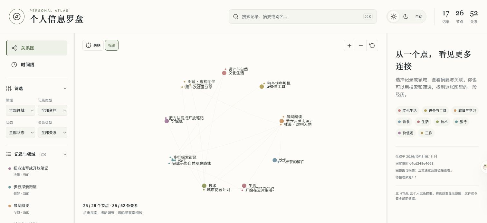
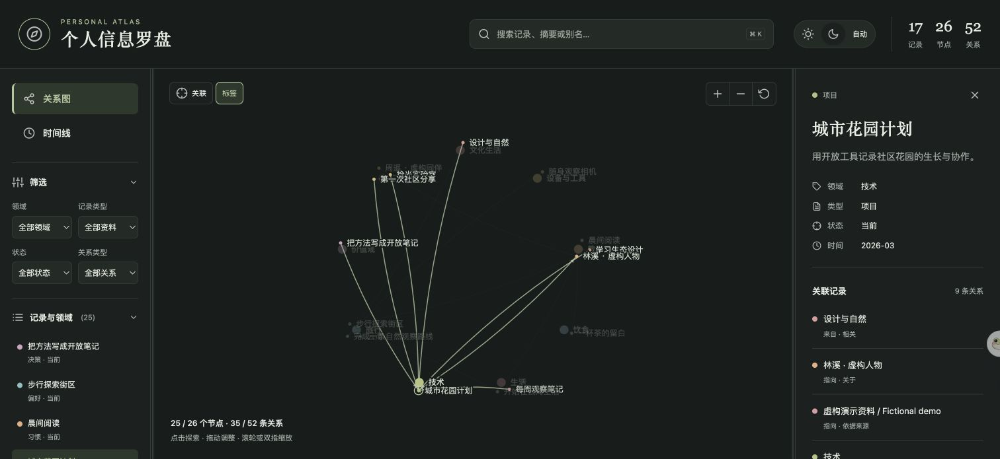
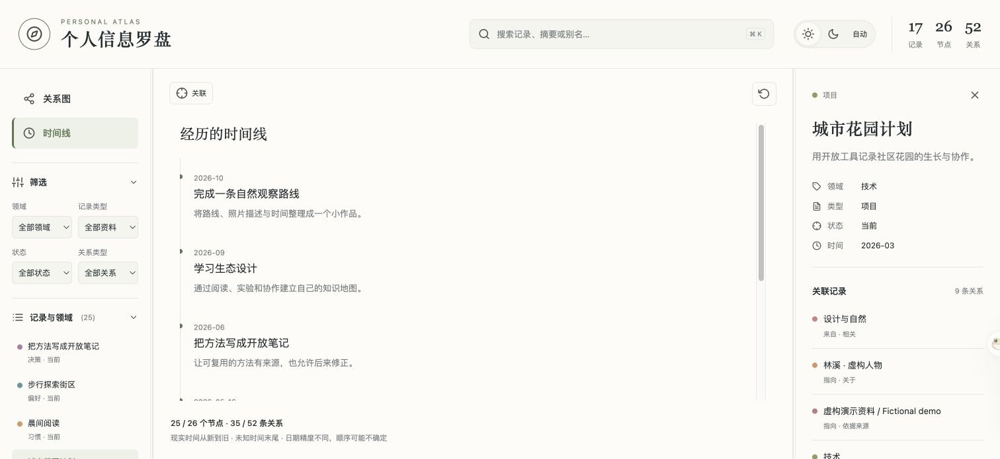

# Personal Atlas · 个人信息罗盘

**让 AI 拥有一张你能查看、纠错、自己掌控的个人知识地图。**

[English](README.md) · [Skill 操作说明](SKILL.md) · [贡献指南](CONTRIBUTING.md) · [MIT 许可证](LICENSE)

Personal Atlas 是一个 Agent Skill：把你愿意保存的经历、项目、偏好、目标与关系，
整理成可追溯的个人知识库。Markdown 保存细节与原始资料，JSON 图连接信息，
数据存放在你自己控制的 Git 仓库，通过 Agent 已有工具访问。



*截图来自实际导出的界面，全部资料均为虚构。当前 Skill 操作说明和可视化界面以中文为主；项目提供中英文 README。*

## 可以做什么

- **引导建库**：按 12 个主题逐步整理个人资料，可以跳过问题，也可以指定“不保存”。
- **带来源地回忆**：沿人物、项目、事件及其关系定位记录，追溯原话与证据。
- **保留变化与不确定性**：区分事实和推断，记录现实时间，支持纠错、撤回和阶段变化。
- **离线浏览图谱**：在独立 HTML 中搜索、筛选、缩放、探索关联、切换主题与查看时间线。
- **掌控自己的文件**：无需专用 Atlas 云服务或向量数据库，以 Git 保留可检查的版本历史。

<details>
<summary>查看深色主题与时间线</summary>





</details>

## 开始使用

### 1. 安装 Skill

将本仓库克隆到 Agent 的技能目录，文件夹名为 `personal-atlas`；也可以使用宿主提供的 Skill 导入方式。
本机 Codex 的安装示例：

```sh
git clone https://github.com/Charlie-BU/Personal-Atlas.git ~/.codex/skills/personal-atlas
```

仓库根目录就是 Skill 目录，`SKILL.md`、`references/`、`scripts/` 和 `assets/` 应一起保留。
其他宿主需支持 Agent Skills 并提供适配的仓库工具。这是独立技能，安装后仍需配置数据仓库与连接能力。

### 2. 连接独立的私有资料仓库

为个人资料新建一个**空的私有仓库**，不要预置 README 等文件。
为 Agent 连接 Git 工具并授权访问该仓库。当前公开仓库用于分发代码，不用于保存你的个人档案。

可以对 Agent 说：

> 使用 Personal Atlas。我的空私有资料仓库是
> `https://github.com/YOUR-NAME/YOUR-PRIVATE-ATLAS`。
> 请检查访问能力、初始化资料库，再引导我完成首次访谈。敏感主题保存前先询问我。

仓库配置可以来自当前对话、宿主或插件说明，也可选择外部
`~/.config/personal-atlas/config.json`。上下文与已有授权足够时，无需本机配置文件或额外 PAT。
凭据放在 Skill 外，不要贴到聊天或提交到仓库。

支持通过宿主适配工具访问 GitHub、GitLab、Gitee 和自建 Git 服务。
Skill 自身不包含认证或远端客户端。写入要求有受信任的计算/校验能力、
一次多文件原子提交、并发保护和远端回读能力。
平台支持取决于宿主能力，不表示所有平台均已实测，详见[连接器要求](references/connector.md)。

### 3. 保存、检索与浏览

可以这样使用：

- “引导我整理做过的项目，任何问题都允许跳过。”
- “当时为什么作出这个决定？请给出原始来源。”
- “更新这个偏好，旧描述已经不准确了。”
- “生成我的可交互 Atlas，并展示时间线。”

初始化只有在实际远端提交与回读成功后才算完成。脚本返回 `prepared`
表示变更已准备好，需要宿主工具发布，不等于资料已经远端保存。

## 体验虚构演示

推荐 Python 3.10+，Python 辅助脚本仅使用标准库；本地 Node.js 为可选，用于额外的 DOM 契约检查。

```sh
python3 -B examples/build_demo.py --output /tmp/personal-atlas-demo.html
```

用浏览器打开生成的 HTML 即可离线体验。脚本仅使用虚构资料，
不读取个人资料库或配置，不发起网络请求；目标文件已存在时需换一个文件名。
演示不含指向真实个人资料仓库的正文链接。

## 工作方式

```text
Agent + 已有 Git 工具
          ↓ 固定提交快照
Markdown 记录、原始来源与 JSON 关系图
          ↓ 内存校验与变更准备
一次受并发保护的远端提交 + 回读验证
          ↓ 按需生成
包含完整图与摘要的独立交互 HTML
```

个人记录、原始资料、图索引和操作历史保存在远端数据仓库。
辅助脚本在内存计算，不建立本地资料库、缓存或同步队列。
按需生成的 HTML 是本地交付文件，包含完整图与摘要；完整正文和原件仍需访问仓库。

## 隐私与能力边界

只保存你授权的内容，建议使用私有资料仓库，并为连接工具提供所需范围的访问权。
**HTML 文件内嵌个人摘要，筛选只改变显示范围，不移除数据。** 对外分享前检查内容。
普通删除不会清除 Git 历史、既有克隆或此前导出的 HTML。

检索采用有范围的图导航与文本匹配，没有向量搜索。
问答和信息提取的准确性仍依赖 Agent。自动测试覆盖计算逻辑与界面契约，
不能替代真实账号读写及不同宿主、平台的端到端验收。

## 开发与目录

```sh
python3 -B -m unittest discover -s scripts -p 'test_*.py' -v
```

| 路径 | 用途 |
| --- | --- |
| `SKILL.md` | Agent 工作流与操作规则 |
| `references/` | 访谈、结构、检索、修改、存储、时间和可视化说明 |
| `scripts/atlas.py` | 纯计算与结构校验 |
| `scripts/visualization.py` | 完整图读取与离线 HTML 导出 |
| `assets/` | 共享 HTML 模板与内嵌图标 |
| `examples/build_demo.py` | 虚构资料演示生成器 |
| `docs/history-map.json` | 原始提交与抽离后提交的映射 |

## 历史与开源协议

从 [PersonalSkills](https://github.com/Charlie-BU/PersonalSkills) 的 `personal-atlas/`
抽离，保留源 HEAD 祖先中涉及该目录的全部 11 次提交，包括作者、时间、说明和每个版本的文件树。
目录提升到根目录会改变提交 SHA，详见[历史说明](docs/HISTORY.md)和[提交映射](docs/history-map.json)。

采用 [MIT 许可证](LICENSE)。Feather 图标保留[原始 MIT 声明](assets/feather-LICENSE.txt)，
详见[第三方声明](THIRD_PARTY_NOTICES.md)。欢迎通过中文或英文 Issue / PR 贡献，
提交前请阅读[贡献指南](CONTRIBUTING.md)与[安全说明](SECURITY.md)。
